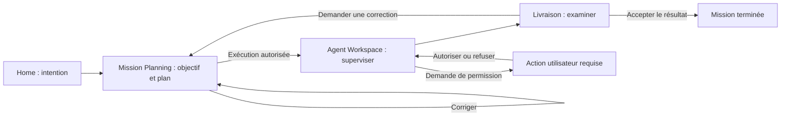

# SOLAR — Architecture UX adaptative

Version 1.0 · Cible fonctionnelle. Les croquis ci-dessous sont des maquettes textuelles à réaliser dans l'app existante. Les [planches conceptuelles originales](references/README.md) sont disponibles en complément ; ce ne sont pas des captures de l'application exécutée. La planche principale montre Home, Workspace et Modifications ; Mission Planning reste à détailler en haute fidélité.

## Parcours et continuité



La conversation est le fil conducteur. Les transitions modifient la composition, pas l'identité du dialogue. Une simple question peut rester une conversation sans mission d'exécution. Une mission active reste accessible en quittant sa vue ; un événement d'agent ne change jamais de force l'onglet consulté.

## Navigation cible

| Niveau | Destinations | Règle |
|---|---|---|
| Global immédiat | Home, Projets, missions actives, Réglages utiles | Réutiliser le shell et les projets locaux |
| Global progressif | Agents, Missions, Bibliothèque | N'apparaissent comme destinations interactives que lorsque leurs écrans ont un contenu réel |
| Projet | Vue d'ensemble, espace de travail, missions, fichiers, réglages | Le dossier et le projet restent explicites |
| Workspace de mission | Conversation, Plan, Fichiers, Modifications, Preview | Conserver état de lecture et composer |

Il s'agit de destinations logiques portées par des états/vues GPUI, pas de routes web à créer. Les onglets de sessions existants restent accessibles ; ne pas les remplacer par une navigation neuve qui perd l'historique.

La barre de contexte affiche le projet, la mission, l'état de l'exécution et les actions réellement disponibles. Les cinq vues sont des onglets **internes à la mission**, distincts des onglets de sessions déjà présents. Éviter deux bandes de navigation également dominantes ; la bande de sessions peut être compacte, mais son modèle persistant est préservé.

## 01 — Home : exprimer l'intention

```text
┌ SOLAR ──────────────────────────────────────────────────────────┐
│ Home         │                                                  │
│ Projets      │              Qu'est-ce qu'on construit ?          │
│ Missions (2) │                                                  │
│              │     ┌ Décris ce que tu veux construire… ───────┐  │
│ Projet actif │     │                                         │  │
│ solar-core   │     │ +  Opus High ˅   Accès complet ˅      ↑ │  │
│              │     └─────────────────────────────────────────┘  │
│              │       solar-core   main (branche)                │
│              │     Projets récents      Mission à reprendre      │
│ Réglages     │     solar-core           Authentification         │
└──────────────┴──────────────────────────────────────────────────┘
```

**Action principale** : envoyer une demande. Secondaires : choisir/ajouter un dossier, reprendre une conversation, joindre une image supportée. Les actions rapides insèrent un exemple dans le composer ; elles ne lancent pas une exécution inattendue.

- Sans projet, conserver texte et images en brouillon puis demander un dossier avant d'ouvrir un processus Claude qui exige un `cwd`.
- La création d'un dossier nouveau est une action explicite, jamais une conséquence silencieuse du premier prompt.
- Un projet choisi depuis la Home devient le contexte de la conversation ; ne pas envoyer le même texte dans une ancienne session par erreur.
- Le sélecteur présente seulement les modèles reçus. Tant que le CLI n'est pas prêt : état explicite, sans liste de modèles inventée.
- Le choix automatique d'agent reste absent tant que la sélection d'agents n'est pas implémentée. (Le mode de permission « Auto », lui, existe : c'est le relecteur automatique de l'agent.)
- Dossier absent ou déplacé : proposer de le localiser ; conserver les sessions associées.
- Échec de démarrage du CLI : expliquer l'absence ou le problème d'accès, permettre de réessayer et conserver le brouillon.

Le composer réutilise l'envoi multiligne, le collage/dépôt d'images, `/`, `@`, modèle/effort et modes existants. Les limites actuelles sont documentées dans l'audit ; tout changement de ces comportements reste un incrément séparé.

## 02 — Mission Planning : rendre le travail compréhensible

```text
┌ SOLAR ─ solar-core / Nouvelle mission ─ Préparation ──────────────┐
│ Navigation │ Conversation            │ Plan proposé              │
│            │ « Ajoute une connexion │ Objectif                   │
│            │ par e-mail… »          │ Connexion et session       │
│            │                        │                            │
│            │ Résumé du contexte     │ 1 Analyser les conventions │
│            │ Hypothèses à confirmer │ 2 Implémenter              │
│            │                        │ 3 Vérifier et relire       │
│            │                        │ Dépendances · Agents       │
│            │                        │ Critères · Permissions     │
│            │ [Corriger le plan…]    │ Modifier  Lancer la mission│
└────────────┴────────────────────────┴────────────────────────────┘
```

**Action principale** : « Lancer la mission » lorsque le plan est prêt et que l'utilisateur a le contexte nécessaire. Le bouton ne lance pas une opération supplémentaire s'il ne fait que sauvegarder le plan : séparer « Enregistrer » et « Lancer » si nécessaire.

Le plan comporte un objectif court, le périmètre inclus/exclu, les hypothèses, la base du dépôt observée, les étapes et dépendances, le résultat attendu de chacune, les rôles/modèles disponibles, les validations et opérations sensibles. Afficher le coût seulement si une donnée réelle existe, ou marquer clairement une estimation.

**Avant lancement** : vérifier le dossier, les capacités de l'adaptateur, le mode de permission effectif et la version du plan. Préserver les changements utilisateur antérieurs. Un plan doit rester révisable ; un changement de périmètre important crée une nouvelle version et invalide les décisions périmées.

**Séparation indispensable** : préparer un plan dans l'UI ne bloque pas les écritures du CLI. Le moteur doit utiliser un mode compatible avec une préparation sans mutation et traiter les permissions au moment des opérations. Le mode actuel « Accès complet » est un écart à résoudre explicitement, pas un détail de mise en page.

**États** : préparation en cours, besoin de précision, proposition prête, modification, vérification avant lancement, lancement en cours, échec récupérable, annulé. La fermeture de Planning conserve demande et plan ; elle ne marque pas la mission comme réussie.

## 03 — Agent Workspace : superviser et intervenir

```text
┌ SOLAR ─ solar-core / Authentification ─ En cours ─ Arrêter ───────┐
│ Projets    │ Conversation  Plan  Fichiers  Modifications  Preview │
│ Sessions   ├────────────────────────────────────────────────────┤
│            │ Fil de conversation                                │
│ Mission    │ Analyse terminée. Implémentation en cours.          │
│ active     │                                                    │
│            │ Activité récente · Implémenteur · 2 fichiers        │
│            │ [Voir l'activité]                                  │
│            │                                                    │
│            │ ┌ Écrire une précision… ─────────────────────────┐ │
│            │ │ Modèle · Mode                        Envoyer  │ │
│            │ └───────────────────────────────────────────────┘ │
└────────────┴────────────────────────────────────────────────────┘
```

L'activité détaillée est un panneau à la demande. En grande largeur, le plan ou la preview peut être épinglé à côté de la conversation ; cette disposition ne devient jamais obligatoire. En largeur compacte, une seule surface de contenu domine et l'accès au dialogue reste immédiat.

| Vue | Question à laquelle elle répond | Comportement |
|---|---|---|
| Conversation | Que demande-t-on, que se passe-t-il ? | Dialogue durable, activité factuelle, permissions contextualisées |
| Plan | Que reste-t-il et pourquoi cela attend-il ? | Tâches, rôles, dépendances et résultats, sans progression fictive |
| Fichiers | Qu'y a-t-il dans le projet ? | Arborescence et lecture de code ; distinguer cette vue du simple menu `@` |
| Modifications | Qu'est-ce qui a changé ? | Diff sur base explicite, décisions et conflits |
| Preview | Quel résultat puis-je observer ? | Contenu lié au projet/exécution et état de disponibilité vérifiable |

### Conversation et contrôle

- Conserver session et abonnement aux événements lors d'un changement de vue ; masquer n'est pas détruire `SessionView`.
- Pendant une lecture ancienne, signaler les nouveaux messages et proposer « Aller au dernier message » ; ne pas forcer le scroll.
- Une permission indique l'action, le fichier ou la portée et la conséquence. Rendre la demande accessible depuis toutes les vues sans voler le focus.
- « Arrêter » envoie une interruption ; afficher « Arrêt demandé » jusqu'à confirmation. Ne pas promettre une pause/reprise durable si l'adaptateur ne le permet pas.
- Envoyer un message pendant une exécution indique clairement s'il est reçu immédiatement ou mis en file. Ne pas le présenter comme une modification de plan déjà prise en compte.
- Fermer un onglet actif peut tuer le processus dans le code actuel : avant toute évolution de navigation, décider explicitement comment avertir, conserver ou arrêter une exécution. Ne pas confondre fermeture d'un panneau et fermeture de session.

### Plan et agents

Séparer tâche, rôle et état de l'exécutant. Un agent peut attendre une dépendance sans être en erreur. Une carte indique la tâche active et sa dernière activité réelle. La timeline agrège les événements, mais conserve les identifiants de l'exécution et de l'agent pour les détails.

Au départ, montrer un seul agent Claude. Puis introduire des rôles séquentiels réels. Ne pas afficher trois agents « actifs » pour habiller une unique conversation.

### Modifications et livraison

```text
┌ solar-core / Authentification ─ Changements prêts à examiner ────┐
│ Fichiers modifiés    │ src/auth.rs       +24 / −3                 │
│ src/auth.rs         │ Base : état avant exécution                │
│ tests/auth.rs       │ Diff unifié / côte à côte selon la largeur │
│                     │ Motif du changement                        │
│ Validation          │                                            │
│ Tests : non exécutés│ Changements déjà sur disque / isolés       │
│                     │ Demander correction   Accepter le résultat │
└─────────────────────┴────────────────────────────────────────────┘
```

Le résumé de livraison couvre objectif, fichiers, validations, limites et prochaine action. Une revue doit identifier l'ensemble exact examiné. Si un fichier change après affichage du diff, marquer la revue obsolète et recalculer avant acceptation.

**Acceptation** : décision sur le résultat, avec portée et version ; pas un commit implicite. **Refus** : demande de correction ou rejet documenté ; il n'efface aucun fichier sans mécanisme fiable et confirmation de la portée. **Restauration** : disponible uniquement si un checkpoint vérifié permet d'annuler les changements de la mission en protégeant les modifications utilisateur. Aucun `reset --hard` pour réaliser une action UX.

Prévoir fichiers créés/supprimés/renommés, binaires, gros fichiers, diff vide, conflits et dépôt sans commit. Le projet SOLAR inspecté n'a pas de premier commit : la revue future ne peut pas dépendre exclusivement de `HEAD`.

### Preview et diagnostics sans terminal

La preview concerne d'abord les projets capables d'exposer un aperçu compatible. Pour un projet natif ou un backend sans vue, indiquer « Aperçu indisponible pour ce projet » et proposer les résultats réellement accessibles. Ne pas afficher une fausse page pour simuler le fonctionnement.

L'origine, le projet et la version observée restent identifiables. Distinguer démarrage du serveur, chargement, prêt, erreur et version périmée. Ne pas arrêter un serveur de l'utilisateur lors de la fermeture de la vue ; gérer seulement les processus créés et identifiés par SOLAR. Toute nouvelle capacité de webview doit être vérifiée dans la stack actuelle.

Les exécutions internes peuvent employer des commandes. L'UI expose leur objectif, état et résultats structurés : tests réussis/échoués, diagnostics et détails repliables copiables. Aucun onglet Terminal, shell interactif, invite de commande, émulation ANSI ou console brute utilisée comme écran principal.

## Modèle d'états cible

| Objet | États proposés | Règle |
|---|---|---|
| Mission | Brouillon, Préparation, Prête, En cours, À examiner, Terminée, Annulée, Bloquée | Terminée après décision et critères vérifiés ; pas au premier `TurnDone` |
| Tâche | À faire, Prête, En cours, Bloquée, À relire, Terminée, Annulée | Dépendances satisfaites avant lancement |
| Exécution | En attente, Démarrage, Active, Attend l'utilisateur, Arrêt demandé, Interrompue, Réussie, Échouée | Chaque tentative a son identité ; une tentative échouée n'efface pas la mission |
| Agent/affectation | Inactif, Réflexion, Travail, Attente dépendance, Attente utilisateur, Revue, Succès, Erreur | Statut dérivé d'événements, pas d'un minuteur |
| Validation | Non exécutée, En cours, Réussie, Échouée, Interrompue | La non-exécution ne compte pas comme réussite |

Le `Status` actuel de session est seulement `Idle / Working / NeedsYou`. Il reste compatible avec le chat pendant l'introduction des états métier ; ne pas transformer toutes les sessions importées en missions artificielles.

Règles de transition : approuver un plan crée/autorise une tentative ; refuser une permission laisse une décision exploitable ; une dépendance échouée bloque les tâches concernées ; un nouvel essai crée une exécution distincte. Un crash laisse un état à réconcilier avec les processus et fichiers, sans relance automatique d'une action sensible.

## Persistance et reprise

À ajouter progressivement : brouillon par conversation, mission et version du plan, exécution active, vue sélectionnée, scroll, fichier/diff consulté, décisions et checkpoints. Les événements se corrèlent par identifiants stables ; les mises à jour dupliquées ne créent pas deux tâches ou deux acceptations.

Les projets/sessions/onglets actuels restent lisibles. Toute évolution du JSON prévoit des valeurs par défaut, une version ou migration testée et une sauvegarde ; ne pas modifier les historiques Claude pour y stocker les missions SOLAR. Les secrets ou contenus sensibles ne doivent pas être copiés sans nécessité dans une nouvelle timeline.

## Adaptation aux tailles et accessibilité

| Surface | Composition proposée |
|---|---|
| Grande fenêtre, environ 1280 et plus | Sidebar rétractable, conversation et un panneau contextuel facultatif |
| Moyenne, environ 900–1279 | Navigation compacte ; contenu principal, panneau en overlay ou vue dédiée |
| Compacte, 720–899, hauteur minimale 480 | Sidebar fermable, une vue à la fois, actions essentielles accessibles, composer contenu |
| Mobile futur, repères 390 et 430 | Conversation, suivi, permissions et résumés ; revue simplifiée avec ouverture du diff complet si nécessaire |

Les seuils sont des propositions en unités logiques, à vérifier sur l'app. Aucun client mobile ou route responsive web n'est créé ici. Sur mobile, ne pas demander d'approuver un changement dont le périmètre n'est pas consultable.

Parcours clavier cible : navigation globale → session/mission → vues → contenu → composer/actions. Les dialogues rendent le focus à leur déclencheur. Entrée envoie et Maj+Entrée insère une ligne selon le comportement existant ; Tab valide une suggestion lorsqu'elle est active, et l'utilisateur doit pouvoir quitter ce menu pour poursuivre sa navigation. Échap ferme d'abord un overlay actif ; l'interruption actuelle sur Échap doit être revue explicitement pour éviter une annulation accidentelle. Cmd+Q conserve la convention native.

## Scénarios de réception à vérifier dans la vraie app

1. Premier lancement sans projet : saisie, sélection de dossier, conservation du brouillon, plan sans mutation.
2. Projet et session importés : reprise du fil sans réinterpréter l'historique comme mission.
3. Plan corrigé, refusé puis approuvé : version, permissions et contexte exacts au lancement.
4. Streaming en arrière-plan : cinq changements de vue, retour à la conversation sans perte ni auto-scroll intrusif.
5. Permission pendant une revue : alerte lisible, décision possible, retour au même diff.
6. Interruption puis fermeture/réouverture : état honnête, reprise explicite, aucune fausse exécution active.
7. Changements utilisateur antérieurs : diff ciblé, revue périmée signalée et restauration sans perte de travail.
8. Preview absente, crashée ou périmée : explication et moyen de continuer.
9. CLI absent, dossier déplacé, historique volumineux : erreur récupérable et interface réactive.
10. Clavier, VoiceOver, FR/EN, fenêtre minimale et réduction du mouvement : actions accessibles, contexte préservé.
